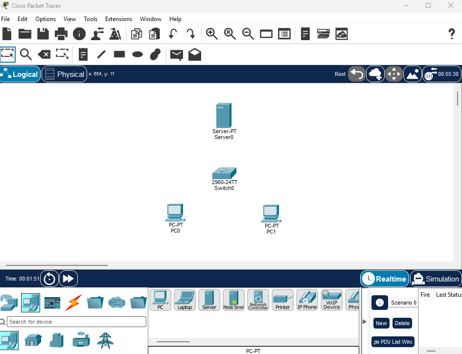
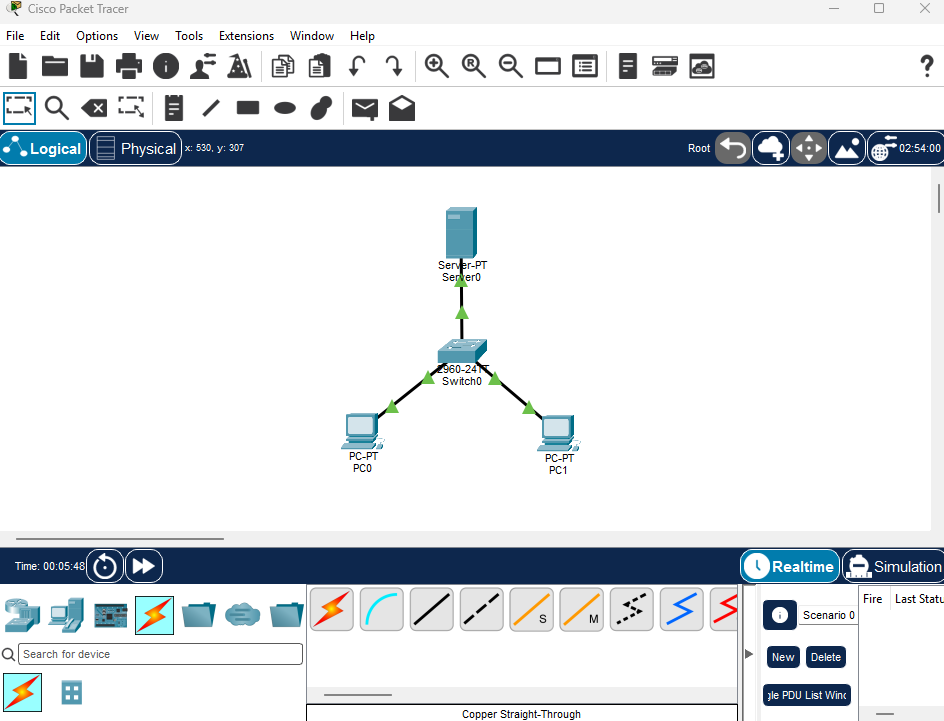
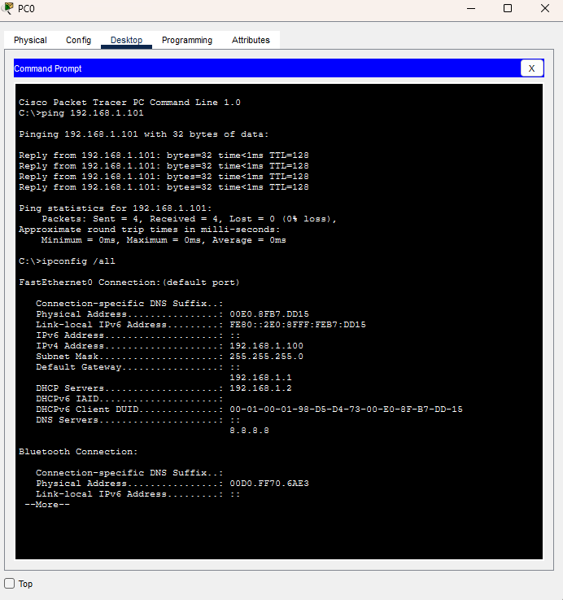
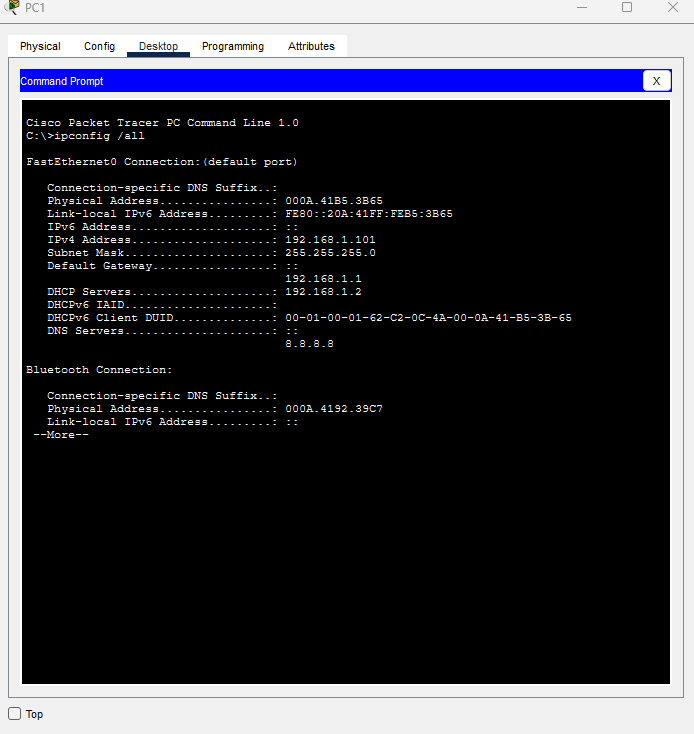

# DHCP Configuration Lab — Automatic IP Address Assignment & Network Connectivity

**CompTIA Network+ (N10-009) | Cisco Packet Tracer | Network Configuration**

## Introduction

Dynamic Host Configuration Protocol (DHCP) automatically assigns IP addresses and other network settings to devices.

Without DHCP, network administrators would need to manually configure IP addresses on individual computers, which takes time and increases the possibility of configuration errors.

In this lab, I configured a DHCP server in Cisco Packet Tracer, connected two client computers, verified automatic IP address assignment, and tested network connectivity.

## Lab Objectives

- Build a small local area network (LAN).
- Configure a server with a static IP address.
- Create and configure a DHCP address pool.
- Automatically assign IP addresses to two computers.
- Verify DHCP settings using Windows-style command-line tools.
- Test communication between network devices.

## Tools and Equipment

- Cisco Packet Tracer
- One Cisco 2960 switch
- One Server-PT
- Two PC-PT computers
- Copper straight-through Ethernet cables
- DHCP
- Command Prompt

## Step 1 — Building the Network Topology

I began by adding one server, one switch, and two computers to the Packet Tracer workspace.

The server was positioned above the switch, with both computers below it.



The switch connects all devices within the same local network.

## Step 2 — Connecting the Devices

I connected the server and both computers to the Cisco 2960 switch using copper straight-through Ethernet cables.

| Device | Switch Port |
|---|---|
| Server0 | FastEthernet0/1 |
| PC0 | FastEthernet0/2 |
| PC1 | FastEthernet0/3 |



All connections displayed green indicators, confirming that the physical network links were active.

## Step 3 — Configuring the DHCP Server

Before enabling DHCP, I configured Server0 with a static IPv4 address.

| Setting | Configuration |
|---|---|
| IP Address | 192.168.1.2 |
| Subnet Mask | 255.255.255.0 |
| Default Gateway | 192.168.1.1 |

Using a static IP address ensures that the DHCP server maintains a consistent network address.

Next, I opened **Server0 → Services → DHCP** and enabled the DHCP service.

I created an address pool named `LAN` using these settings:

| Setting | Value |
|---|---|
| Pool Name | LAN |
| Starting IP Address | 192.168.1.100 |
| Subnet Mask | 255.255.255.0 |
| Default Gateway | 192.168.1.1 |
| DNS Server | 8.8.8.8 |
| Maximum Users | 50 |

The DHCP pool was configured to automatically distribute addresses beginning at `192.168.1.100`.

The gateway address was configured for demonstration purposes. No router was included in this local network.

### Troubleshooting the DHCP Pool

During testing, I discovered that Packet Tracer also contained a default DHCP pool named `serverPool`.

This pool initially used an overlapping address range, which caused an unexpected IP address assignment.

I adjusted its starting address and pool size to prevent overlap with the LAN pool.

After refreshing the client configuration, DHCP assigned the expected address successfully.

This demonstrated the importance of checking DHCP pool settings when troubleshooting IP address assignment.

## Step 4 — Testing DHCP on PC0

I opened **PC0 → Desktop → IP Configuration** and selected DHCP.

The computer automatically received:

| Setting | Assigned Value |
|---|---|
| IPv4 Address | 192.168.1.100 |
| Subnet Mask | 255.255.255.0 |
| Default Gateway | 192.168.1.1 |
| DHCP Server | 192.168.1.2 |
| DNS Server | 8.8.8.8 |

To verify the configuration, I opened Command Prompt and entered:

```text
ipconfig /all
```

I also tested communication with PC1 using:

```text
ping 192.168.1.101
```



The ping test returned four successful replies with 0% packet loss.

This confirmed that PC0 could successfully communicate with PC1 across the local network.

## Step 5 — Testing DHCP on PC1

Next, I opened **PC1 → Desktop → IP Configuration** and selected DHCP.

PC1 automatically received a different IP address.

| Setting | Assigned Value |
|---|---|
| IPv4 Address | 192.168.1.101 |
| Subnet Mask | 255.255.255.0 |
| Default Gateway | 192.168.1.1 |
| DHCP Server | 192.168.1.2 |
| DNS Server | 8.8.8.8 |

I verified the configuration using:

```text
ipconfig /all
```



The results confirmed that PC1 received its network settings from the DHCP server.

Both computers received unique IPv4 addresses.

## Lab Results

| Test | Result |
|---|---|
| Network topology created | Successful |
| Devices physically connected | Successful |
| Static server IP configured | Successful |
| DHCP pool configured | Successful |
| PC0 automatic IP assignment | 192.168.1.100 |
| PC1 automatic IP assignment | 192.168.1.101 |
| DHCP server identification | 192.168.1.2 |
| PC0-to-PC1 ping test | Successful |
| Packet loss | 0% |

## What I Learned

This lab demonstrated how DHCP simplifies network administration.

My key takeaways were:

1. **DHCP automatically assigns IP addresses.** Devices do not require manual IP configuration.
2. **Servers should have consistent IP addresses.** Static addresses make important services easier to locate.
3. **DHCP pools define available addresses.** Administrators control which IP addresses clients can receive.
4. **IP addresses must be unique.** Each device requires its own address to communicate properly.
5. **Overlapping DHCP pools can cause configuration problems.** Address ranges should be checked during troubleshooting.
6. **Ping verifies basic connectivity.** Successful replies help confirm that devices can communicate.
7. **The `ipconfig /all` command displays network configuration details.** It can help identify DHCP servers, assigned addresses, and DNS settings.

## Conclusion

This lab successfully demonstrated DHCP configuration and automatic IP address assignment using Cisco Packet Tracer.

I configured a DHCP server, created an IP address pool, connected two client computers, verified their assigned network settings, and tested local network connectivity.

I also gained troubleshooting experience by identifying and correcting an overlapping DHCP pool configuration.

**The key lesson:** DHCP makes network administration easier by automatically assigning unique IP addresses and other network settings to connected devices.

---

## Download the Lab

[Download the Cisco Packet Tracer DHCP Configuration Lab](dhcp-configuration-lab.pkt)

**Lab Environment:** Cisco Packet Tracer

**Certification Focus:** CompTIA Network+ N10-009

**Topics:** DHCP, IPv4 Addressing, LAN Configuration, Network Switching, Troubleshooting, Ping, IP Configuration
